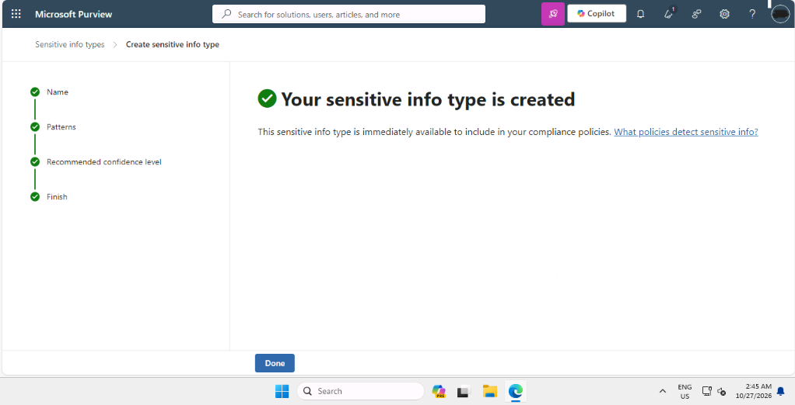
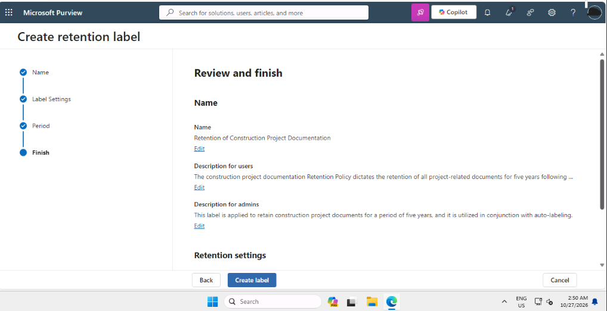
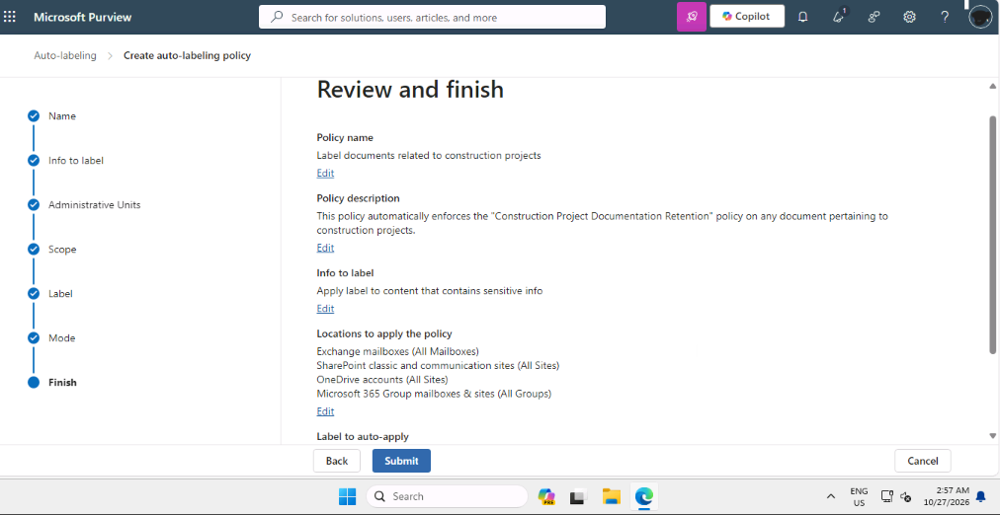
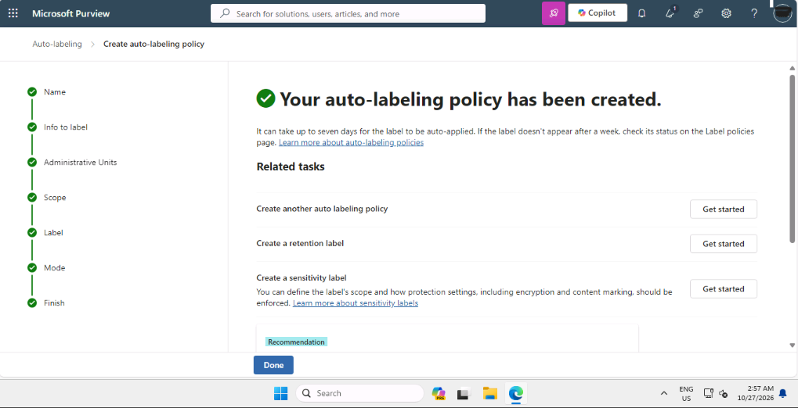

# Data Classification Framework with Microsoft Purview

## Summary

I completed this lab as part of my SC-100 preparation, working as a security architect in a training tenant for a fictional construction company. The company was preparing for an ISO 27001 audit, and its rules said that any document containing a project ID had to be kept for five years. I built three things in Microsoft Purview: a custom sensitive info type that recognises project IDs, a retention label, and an auto-labeling policy that connects the two.

## Tools used

- Microsoft Purview portal
- Information Protection (sensitive info types)
- Data Lifecycle Management (retention labels and label policies)

## What I did

### 1. Created a custom sensitive info type

Purview does not know what a company's project IDs look like, so I taught it. I created a sensitive info type called Project Identification Number and defined a pattern with a regular expression. In my own words, the pattern looks for three letters, an optional separator character, four digits, another optional separator, and two letters. I kept the confidence level at High.

### 2. Created a retention label

Next I created a retention label that keeps documents for five years. I set the retention period to start from when the item was created, and chose to deactivate the retention settings after the period ends.

(Write here which option you picked on the "label is created" page: Do Nothing, or Publish, and why.)

### 3. Auto-applied the label

A label is only useful if it is applied consistently, and people forget to label documents. I created an auto-labeling policy that applies the retention label to any content containing the Project Identification Number. The policy covers Exchange mailboxes, SharePoint sites, OneDrive accounts and Microsoft 365 Groups, and I switched it on rather than leaving it in test mode.

Purview confirmed that the policy was created, and noted that it can take up to seven days for the label to be applied.

## Problems I ran into

While setting up the pattern, I had to ensure the regex account for optional spaces or hyphens so valid IDs would not be missed. Additionally, Purview auto-labeling policies do not trigger instantly—it can take up to seven days for full tenant-wide evaluation, so immediate verification requires relying on the pattern testing tool inside the portal rather than waiting for live deployment.

## What the results mean

- **A sensitive info type** teaches Purview to recognise data that is specific to one organisation.
- **A retention label** decides how long content is kept.
- **Auto-labeling** applies the label consistently, without relying on people to remember.
- **Test mode versus on:** a policy can be tested first to check what it would catch. Switching it on applies the label for real.

## Design note

As an architect, I would test the pattern on sample documents before switching the policy on. A pattern that is too loose could label unrelated documents and keep them for five years without a reason, which is a compliance and cost risk.

## What I learned

I learned that custom Sensitive Info Types allow Microsoft Purview to protect organization-specific data that built-in templates cannot identify. Combining custom SITs with auto-labeling policies ensures consistent compliance with retention rules (like ISO 27001 requirements) without relying on manual user action. Finally, I recognized why testing regex patterns thoroughly is essential to prevent false positives from accidentally locking down unrelated files for five years.
