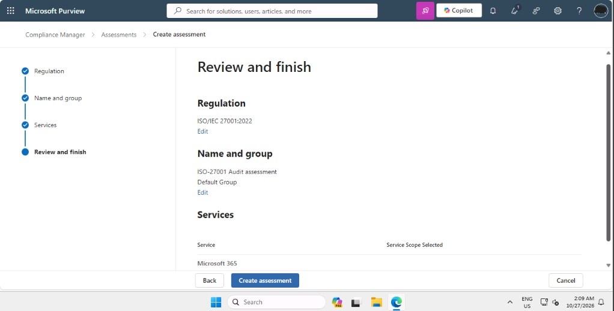
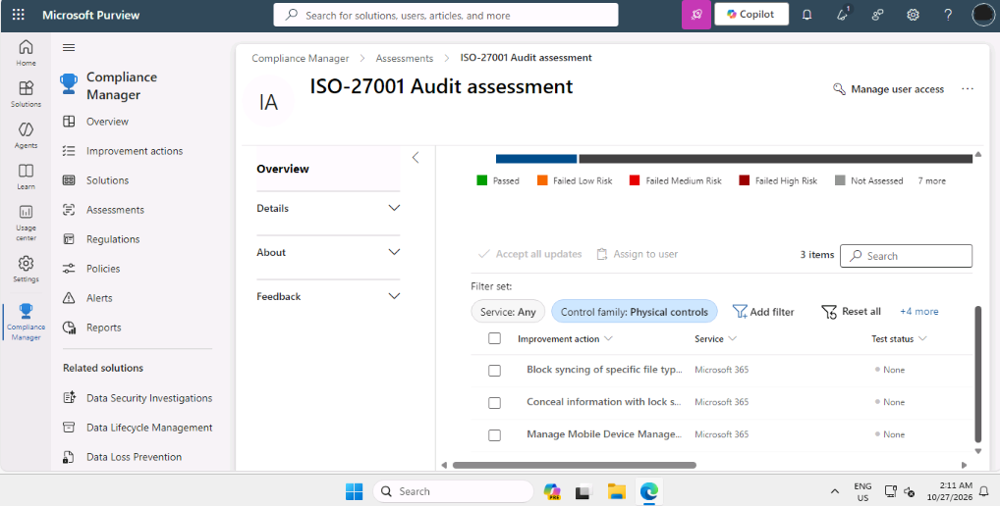
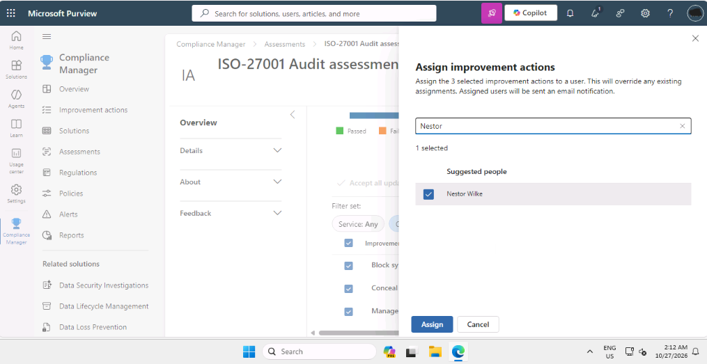

# ISO 27001 Compliance Assessment with Microsoft Purview Compliance Manager

## Summary

I completed this lab as part of my SC-100 preparation, working as a security architect in a training tenant for a fictional company. The company needed to show that it meets the ISO 27001 security standard. I created a compliance assessment, assigned improvement actions to an engineer, and gave that engineer access to the assessment.

## Tools used

- Microsoft Purview portal
- Microsoft Purview Compliance Manager

## What I did

### 1. Created the assessment

In Compliance Manager, I added an assessment based on the ISO/IEC 27001:2022 regulation. I named it, kept the default assessment group, and chose Microsoft 365 as the service in scope. A review page showed these choices before I created the assessment.

### 2. Filtered the improvement actions

An assessment lists many improvement actions, which are tasks that raise the organisation's compliance score. I opened the improvement actions list and filtered it by the Physical controls control family. The filter reduced the list to three actions.

### 3. Assigned the actions to an engineer

I selected the three filtered actions and assigned them to a technical engineer. The portal warned that the assignment overrides any existing ones and sends the person an email notification.

### 4. Gave the engineer access

Assigning tasks is not enough, because the engineer also needs access to the assessment. I used Manage user access and added the engineer with the Assessor role. Assessors can edit test results.

![Assessor added](iso27001-assessor-added.png

## What the results mean

- **An assessment** measures how well an environment meets a standard such as ISO 27001, and gives a score.
- **Improvement actions** are the specific tasks needed to close the gaps.
- **Assigning and access are separate steps.** Without the right role, the engineer could not work on the tasks.
- **The Assessor role** lets someone edit test results, while Reader and Contributor roles allow less or different actions.

## Design note

As an architect, I would give people only the access they need. In this lab the engineer got the Assessor role, so in a real organisation I would check that this role is not broader than the job requires.

## Security note

The people and company in this lab are fictional. In a real tenant, names and email addresses in compliance screens should be covered before anything is shared publicly.

## What I learned

 I learned that managing compliance requires both assigning clear ownership for tasks and ensuring proper Role-Based Access Control (RBAC). In Microsoft Purview, assigning an action is separate from granting system permissions, so an engineer needs the correct role (like Assessor) to record evidence and update scores. This highlighted the importance of following the principle of least privilege when delegating security and compliance responsibilities.
