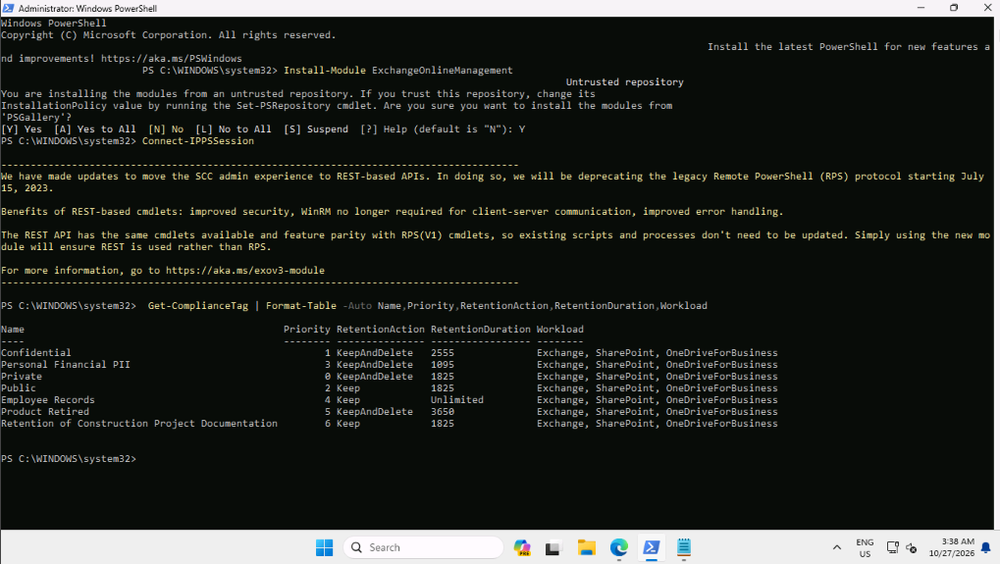
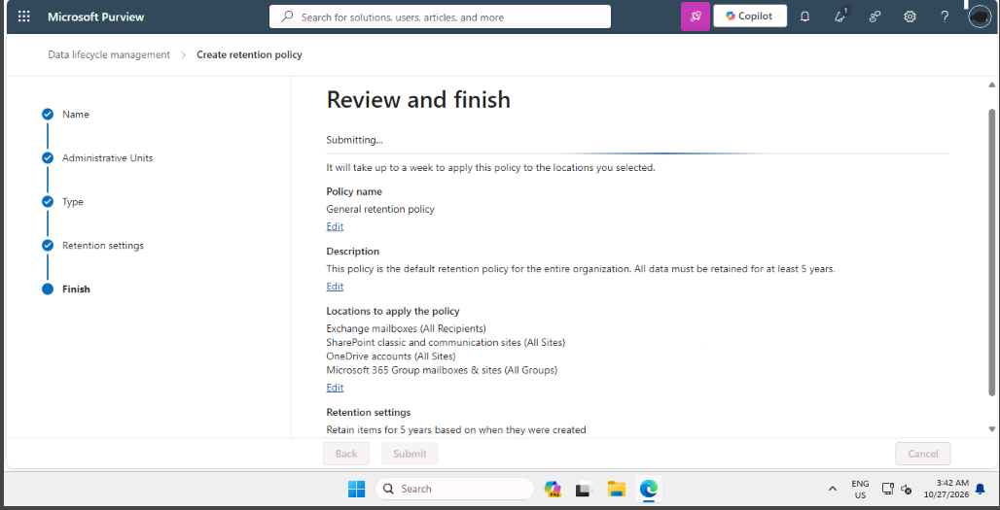
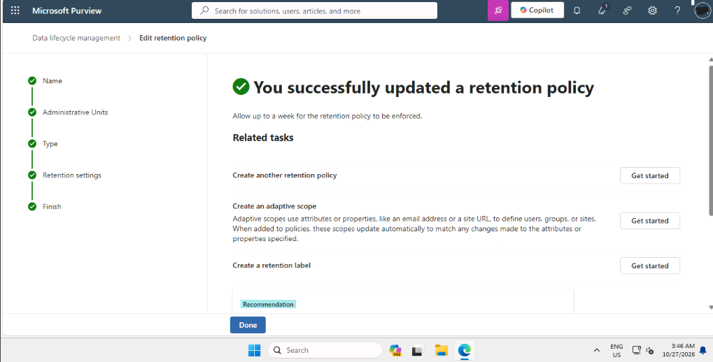
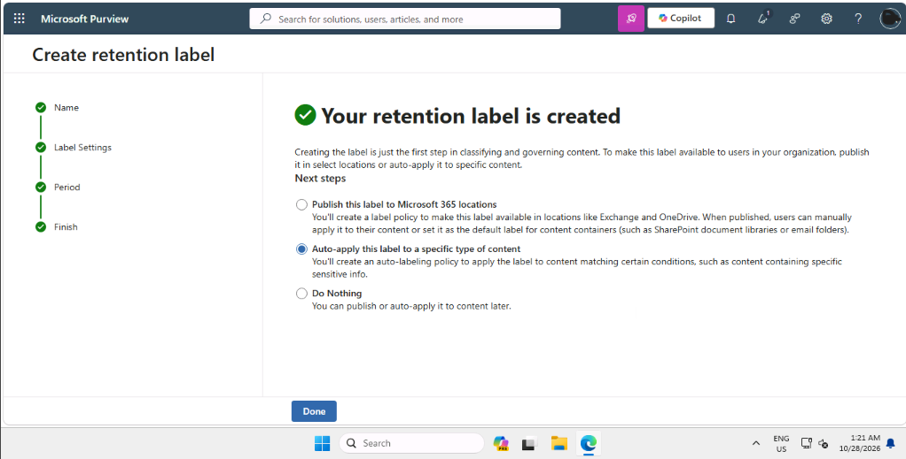

# SC-100 Lab: Retention Policies in Microsoft Purview

## Scenario
Recent changes to German law require financial documents to be kept for 11 years (previously 10), while business correspondence only needs 5 years (previously 7). Contoso's existing 7-year approach no longer fits, and surplus data is driving up storage costs. My job as the architect was to meet the legal minimums without keeping more data than necessary.

## Skills demonstrated
- Auditing existing retention labels with Security & Compliance PowerShell
- Creating an organization-wide retention policy
- Creating a retention label that deletes content after the period ends
- Auto-applying a label using a built-in sensitive info type

## Key concepts
- **Retention policy:** applies a retention rule to whole locations (Exchange, SharePoint, OneDrive, Microsoft 365 Groups).
- **Retention label:** applies a rule to individual items and can be applied automatically.
- **Auto-apply policy:** applies a label to content that matches a condition, such as a sensitive info type.
- **Germany Financial Data:** a built-in sensitive info type, so no custom regex was needed.

## Steps taken

### Task 1: Analyze the existing retention setup
Connected to Security & Compliance PowerShell and listed the existing labels with:

```powershell
Get-ComplianceTag | Format-Table -Auto Name,Priority,RetentionAction,RetentionDuration,Workload
```

**Screenshot 1:** PowerShell output listing the existing labels



**Findings:** the tenant has seven labels. `RetentionDuration` is in days:

| Label | Action | Duration |
|---|---|---|
| Confidential | Keep and delete | 2555 days (7 years) |
| Personal Financial PII | Keep and delete | 1095 days (3 years) |
| Private | Keep and delete | 1825 days (5 years) |
| Public | Keep | 1825 days (5 years) |
| Employee Records | Keep | Unlimited |
| Product Retired | Keep and delete | 3650 days (10 years) |
| Retention of Construction Project Documentation | Keep | 1825 days (5 years) |

None of them provides 11 years for financial documents, so the current setup does not meet the new German requirement. The last label comes from the earlier data classification lab.

### Task 2: Create a company-wide retention policy
Created **General retention policy** as a static policy covering Exchange mailboxes, SharePoint sites, OneDrive accounts, and Microsoft 365 Group mailboxes and sites. It retains items for 5 years from creation, with no action at the end. That meets the 5-year minimum for correspondence without forcing deletion.

**Screenshot 2:** Review and finish page for the General retention policy



**Screenshot 3:** Policy saved. Purview notes enforcement can take up to a week.



### Task 3: German financial data label
Created the retention label **German financial data**, retained for 10 years from creation and then deleted automatically.

On the confirmation page I chose **Auto-apply this label to a specific type of content** (not *Publish*) so the wizard continued straight into an auto-labeling policy.

**Screenshot 4:** Retention label created, with Auto-apply selected



Then created the auto-labeling policy **Automatically retain all German financial data for 10 years**. It uses the built-in **Germany Financial Data** sensitive info type, so no custom regex was needed. The policy applies the label across Exchange mailboxes, SharePoint sites, OneDrive accounts, and Microsoft 365 Group mailboxes and sites, and I turned it on immediately.

**Screenshot 5:** Review and finish page for the auto-labeling policy


## Notes
- **The lab contradicts itself.** The scenario requires 11 years for financial documents, but the lab steps create the label with 10. I followed the lab as written; in a real deployment I would set 11 years.
- **Policies and labels together.** When several retention settings apply to one item, retention wins over deletion and the longest retention period wins. The General policy's 5-year hold and the label's 10-year hold can coexist, and nothing is deleted until all of them have expired.
- **Deletion is irreversible.** The label deletes content automatically, so in production I would test the auto-apply policy in simulation mode first.
- `Get-ComplianceTag` lists retention *labels*, even though the lab text calls them policies.

## What I learned
Through this lab, I learned how Microsoft Purview balances broad location-wide retention policies with granular, sensitive-info-driven retention labels. I saw firsthand how built-in Sensitive Information Types (SITs) automate data lifecycle management across Exchange, SharePoint, and Groups without requiring manual user tagging. Most importantly, evaluating overlapping retention rules reinforced how Purview's Principles of Retention ensure that the longest retention period always takes precedence to maintain legal compliance.

## Exam relevance
Maps to the SC-100 domain on designing solutions for governance, risk, and compliance (GRC).
